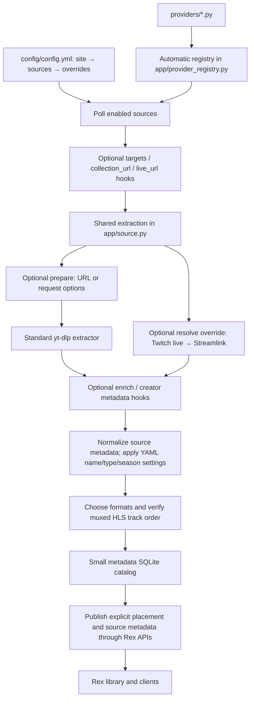
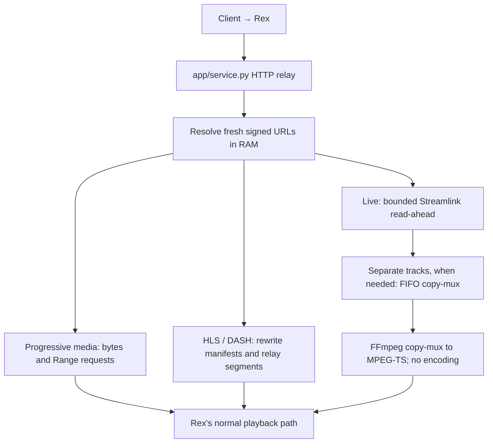

# Architecture

The site folder contains only sites. The shared application does extraction orchestration, metadata placement, publication and relaying. There is no separate playback engine for every provider.

```text
service.py                 Small service launcher
app/
  config.py                YAML validation and inheritance
  provider_registry.py     Automatic discovery of provider files
  source.py                Shared yt-dlp extraction and metadata normalization
  playback.py              Format selection, media metadata and manifest rewriting
  live.py                  Bounded RAM buffering and live copy-muxing
  service.py               SQLite catalog, Rex feed client, HTTP server and poller
  checks.py                Isolated, read-only provider checks
  reporting.py             Generated inventories and Markdown/JSON reports
providers/
  youtube.py               Test URLs and YouTube URL helpers
  vimeo.py                 Test URLs and public embed/metadata helpers
  ...                      Every non-__ Python file is a provider definition
scripts/
  check_providers.py       Check a URL, all discovered sites or configured sources
  probe_sites.py           Optional integration checks using a disposable Rex
  probe_live_buffer.py     Repeatable synthetic interruption test
config/config.example.yml  Commented settings template
reports/PROVIDERS.md        Generated site/handler inventory and diagram
reports/latest.md,json     Latest check; automatically replaced
reports/suite.md,json      Latest complete --all run; automatically replaced
reports/configured.md,json Latest --configured run; automatically replaced
```

## Indexing and metadata



`resolve` is optional. With no such hook, extraction uses yt-dlp. For a generic URL yt-dlp cannot handle, a matching Streamlink live plugin is tried. Ordinary DASH manifests stay on the yt-dlp path. Provider-specific URL knowledge stays in the provider file; the generic poller does not contain a list of hostnames.

For example, **YouTube uses standard yt-dlp for individual videos**. Its URL helpers select uploads, locate an optional channel live endpoint and expand ID-only flat entries. It has no custom video decoder. Vimeo's helpers are different: an anonymous player URL, public oEmbed dates and public creator information. Twitch uses an extraction override for live broadcasts and explicitly selects archived VODs for channel collections.

The [generated provider inventory](../reports/PROVIDERS.md) lists every actual hook with its docstring and a generated handler map. This is regenerated from the code when checks run, so the diagram/table need not be manually updated when another site is added.

## Playback



Media is not downloaded to a cache. The service persists metadata and configuration. Live read-ahead is in RAM; separate-track FIFO pipes do not store regular media files. Rex may use its own normal transcoder output. Saved demo clips are demonstration artifacts, not a service cache.

## Provider checks and generated reports

```mermaid
flowchart LR
    input["CLI URL / --all / --configured or HTTP check"] --> child["Fresh bounded worker process"]
    child --> extraction["Same extraction, normalization and settings"]
    extraction --> temp["Temporary metadata DB + loopback HTTP relay"]
    temp --> probe["ffprobe: observed codecs and tracks"]
    probe --> decode["FFmpeg: decode sample to null output"]
    decode --> seek["Finite VOD: attempt a seek sample"]
    seek --> report["Separate capabilities + stage results"]
    report --> files["Automatic Markdown and JSON reports"]
```



The normal checks do not invoke Rex, publish to its feed, or alter the running service's catalog. Process isolation also prevents a check from replacing the active relay's URL caches or configuration. Each case has an overall deadline; timed-out worker process groups are terminated. A collection check inspects one representative video and states that scope explicitly.

The stages are discovery, extraction, metadata completeness, format selection, artwork access, relay headers, declared-versus-observed feed tracks, decoded playback and seeking. Missing descriptions/posters can produce a partial result while decoded playback still passes. An offline source is distinct from a source that extracted successfully but failed to decode. Skipped live/experimental fixtures are listed explicitly.

The [checking guide](CHECKING_PROVIDERS.md) explains commands, the HTTP endpoint and result levels. The [provider contract](PROVIDER_CONTRACT.md) shows the output a custom extractor must supply. Offline regression tests separately cover configuration, identity, normalization, HTTP behavior, worker isolation, report generation and provider discovery.
