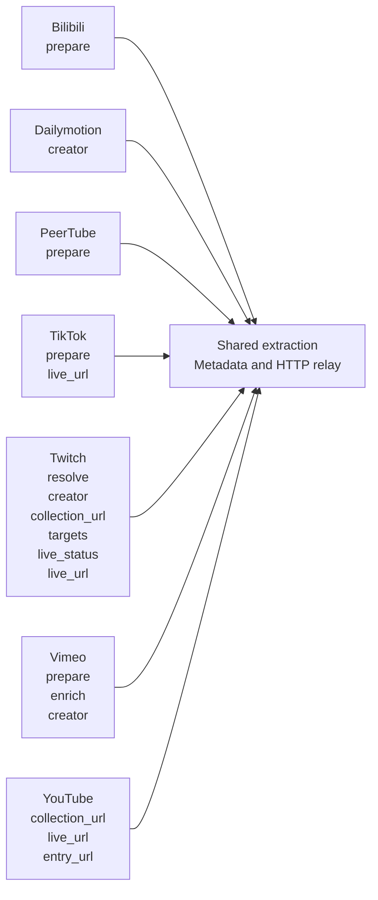

# Provider inventory (generated)

Generated from `providers/*.py`. Every non-dunder site file is discovered automatically. Shared runtime and registry code live in `app/`.

| Provider | Custom handlers | Source |
| --- | --- | --- |
| Bilibili | `prepare` | [providers/bilibili.py](../providers/bilibili.py) |
| Dailymotion | `creator` | [providers/dailymotion.py](../providers/dailymotion.py) |
| PeerTube | `prepare` | [providers/peertube.py](../providers/peertube.py) |
| TikTok | `prepare`, `live_url` | [providers/tiktok.py](../providers/tiktok.py) |
| Twitch | `resolve`, `creator`, `collection_url`, `targets`, `live_status`, `live_url` | [providers/twitch.py](../providers/twitch.py) |
| Vimeo | `prepare`, `enrich`, `creator` | [providers/vimeo.py](../providers/vimeo.py) |
| YouTube | `collection_url`, `live_url`, `entry_url` | [providers/youtube.py](../providers/youtube.py) |

## Handler map

Hooks are optional lifecycle callbacks, not separate playback engines. The map lists only the handlers actually defined by each site file.

## Bilibili

Public extraction remains experimental where the site blocks anonymous access.

- `prepare`: Request anonymous Chrome impersonation; this does not bypass account requirements.

| Test | URL |
| --- | --- |
| video (experimental) | https://www.bilibili.com/video/BV15z4y1F7tK/ |

## Dailymotion

Dailymotion extraction is shared; creator details come from its public API.

- `creator`: Read public biography, avatar and account creation year.

| Test | URL |
| --- | --- |
| video | https://www.dailymotion.com/video/x7bs2wf |
| collection | https://www.dailymotion.com/ComputerHoy |

## PeerTube

PeerTube uses standard yt-dlp output across independent instances.

- `prepare`: Accept the long video-channels URL spelling as the extractor’s /c/ channel form.

| Test | URL |
| --- | --- |
| video | https://framatube.org/videos/watch/9c9de5e8-0a1e-484a-b099-e80766180a6d |
| collection | https://framatube.org/c/joinpeertube/videos |

## TikTok

Anonymous TikTok extraction; no account or persistent cookies.

- `prepare`: Request anonymous Chrome impersonation without loading account cookies.
- `live_url`: Only a public creator root has a corresponding live endpoint.

| Test | URL |
| --- | --- |
| video | https://www.tiktok.com/@astrosamantha/video/7166258449645407493 |
| collection | https://www.tiktok.com/@astrosamantha |
| live | https://www.tiktok.com/@weathernewslive/live |

## Twitch

Archived VOD collections stay separate from transient live broadcasts.

- `resolve`: Resolve live channel roots through Streamlink; VOD extraction remains standard yt-dlp.
- `creator`: Read public channel biography and artwork using yt-dlp’s anonymous client identity.
- `collection_url`: Select archived VODs explicitly so channel trailers are not indexed as episodes.
- `targets`: A channel root indexes its archived uploads and checks its separate live broadcast.
- `live_status`: A recording VOD remains an episode, even when the extractor labels it ongoing.
- `live_url`: Channel roots are live endpoints; /videos collections point to the same creator.

| Test | URL |
| --- | --- |
| video | https://www.twitch.tv/videos/2905866465 |
| collection | https://www.twitch.tv/csharpfritz/videos?filter=archives&sort=time |
| live | https://www.twitch.tv/bashbunni |

## Vimeo

Public Vimeo embed extraction and optional anonymous creator metadata.

- `prepare`: Use the anonymous embed player for numeric video URLs, preserving the public Referer.
- `enrich`: Fill missing upload dates and creator identity from public oEmbed metadata.
- `creator`: Read a public creator biography, avatar and account year.

| Test | URL |
| --- | --- |
| video | https://vimeo.com/1084537 |
| collection | https://vimeo.com/businessofsoftware |

## YouTube

YouTube uses standard yt-dlp extraction, metadata and playback.

Its URL helpers choose uploads/live URLs and expand ID-only flat entries;
individual videos need no YouTube-specific extraction or relay implementation.

- `collection_url`: Select the uploads collection for channel roots; individual and live URLs stay unchanged.
- `live_url`: A public @channel can expose a separate /live endpoint; watch URLs cannot.
- `entry_url`: Convert an ID-only flat entry to its canonical YouTube watch URL.

| Test | URL |
| --- | --- |
| video | https://www.youtube.com/watch?v=aqz-KE-bpKQ |
| collection | https://www.youtube.com/@TechnologyConnections/videos |
| live | https://www.youtube.com/@NASA/live |
